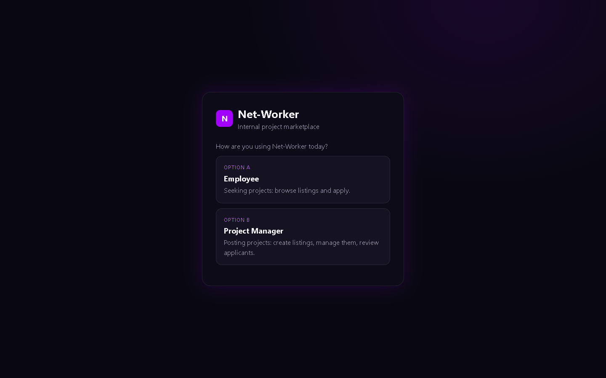
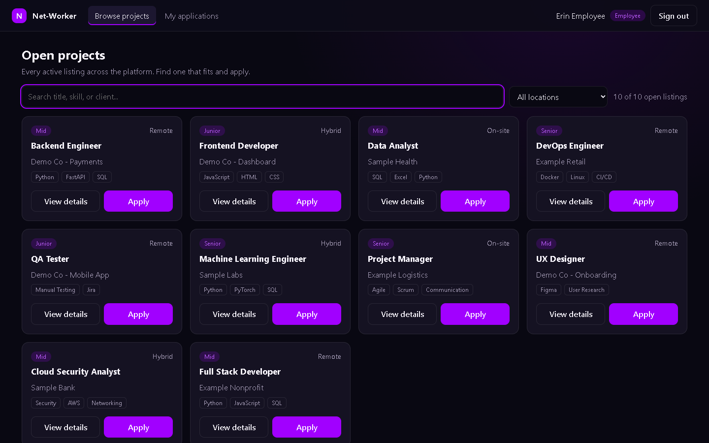
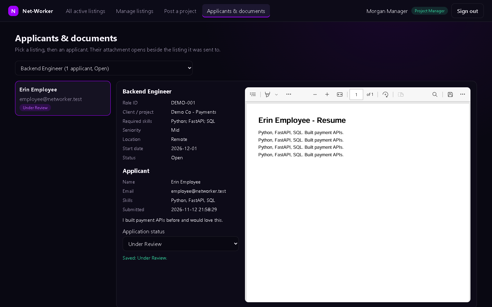

# Login Wall & Role Dashboards - Walkthrough

This explains the new login wall and the two role dashboards in plain English, file by file, so it can be walked through without opening the code.

**The one-line version:** a new entry point, `marketplace/server.py`, wraps the team's existing app without editing it. It adds a login screen with two doors (Employee, Project Manager), remembers who you are with a session cookie, and shows one of two dashboards. Both dashboards are built from the same shared pieces.

## 1. What changed in the repo

Nothing that already existed was edited. Every file below is new.

| File | Lines | What it is |
|---|---|---|
| `marketplace/server.py` | 65 | The new front door. Wraps the existing app and adds the login check. |
| `marketplace/auth.py` | 194 | Login, logout, sessions, test accounts, and the "who may call what" rule table. |
| `marketplace/manager_routes.py` | 233 | Manager-only tools: create listings, change their status, open submitted documents. |
| `marketplace/__init__.py` | 0 | Marks the folder as a Python package. |
| `marketplace/frontend/index.html` | 90 | The page: login wall, app shell, one shared pop-up. |
| `marketplace/frontend/styles.css` | 379 | The look. Same purple palette as the original frontend. |
| `marketplace/frontend/js/components.js` | 208 | Shared building blocks used by both dashboards. |
| `marketplace/frontend/js/employee.js` | 135 | `EmployeeDashboard` (Option A). |
| `marketplace/frontend/js/manager.js` | 307 | `ManagerAdminDashboard` (Option B). |
| `marketplace/frontend/js/app.js` | 163 | The login wall logic and the router that picks a dashboard. |

All files are well under the 800-line cap (largest: 379). Each folder holds 4 files or fewer.

**Untouched:** `backend/`, `frontend/`, `deploy/` and the database schema. The old app still runs exactly as before (`uvicorn deploy.server:app`). The only database addition is a new side table, `marketplace_listings`, which records which manager posted a listing. It is created automatically and does not alter any existing table.

## 2. How the pieces stack

A request to the site passes through these layers in order:

1. **Render / your laptop** hands the request to `marketplace/server.py`.
2. **Team password** (the existing check from `deploy/server.py`, reused as-is). Keeps the whole test site private.
3. **Marketplace login check** (new). Looks at the session cookie and the rule table in `auth.py`.
4. **Where it goes next:**
   - `/mp/auth/...`: log in, log out, "who am I".
   - `/mp/manager/...`: manager tools (`manager_routes.py`).
   - `/api/...`: the team's original backend, unchanged.
   - Anything else: the new frontend files.

`marketplace/server.py` imports `deploy/server.py` instead of copying it. That one import brings along everything Round 1 already solved: the data folder (`DATA_DIR`), the team password, and the demo projects that load on startup.

## 3. The auth flow, step by step



1. **The wall appears.** The page asks the server "who am I?" (`GET /mp/auth/me`). With no valid session the answer is "not logged in", so the page shows the two options.
2. **The person picks a door.** Option A is Employee and Option B is Project Manager. The page shows a sign-in form for that role. In test mode it also shows the matching test account with a "Fill in" button.
3. **The page sends the login.** `POST /mp/auth/login` carries email, password and the chosen role.
4. **The server decides.** `check_credentials()` in `auth.py` is the only place that says yes or no. In test mode the account must exist, the password must match, **and** the account's role must match the door. An employee account cannot walk through the manager door.
5. **A session starts.** The server makes a long random token, stores it in memory next to the person's name, email and role, and sends it back as a cookie named `mp_session`.
6. **Routing.** The page sends the person to `#/employee/browse` or `#/manager/browse`.
7. **Every later request** carries the cookie automatically. The server turns it back into a user before anything else runs.
8. **Signing out** deletes the session on the server and clears the cookie.

### Test accounts

| Door | Email | Password |
|---|---|---|
| Employee | `employee@networker.test` | `employee-demo` |
| Employee | `employee2@networker.test` | `employee-demo` |
| Project Manager | `manager@networker.test` | `manager-demo` |
| Project Manager | `admin@networker.test` | `manager-demo` |

These are fake accounts, and the whole site is still behind the team password.

### Opening it up to anyone's login later

There are two levels, and neither needs frontend changes:

- **Now, with no code change:** set the environment variable `MARKETPLACE_LOGIN_MODE=open`. Anyone can then log in with any email and any non-empty password, as either role. The login wall switches its hint to "Open demo mode" automatically.
- **Later, real company logins (e.g. Microsoft Entra ID / SSO):** replace the body of `check_credentials()` in `marketplace/auth.py`. It is the single swap point. Everything else (sessions, rules, dashboards) already works from the user it returns.

## 4. Session state: what is remembered, and where

| What | Where it lives | How long |
|---|---|---|
| Who is logged in | Server memory (`SESSIONS` in `auth.py`) | 8 hours, or until the server restarts |
| The session token | Browser cookie `mp_session` | Same 8 hours |
| Projects, applications, people | The existing SQLite database | Until the data folder is wiped |
| Uploaded resumes | The existing resume folder in `DATA_DIR` | Same |
| Which tab you're on | The page address (`#/manager/review`) | Until you navigate |

Points worth knowing:

- **The cookie is `HttpOnly`**, so page JavaScript can't read it. **It is `SameSite=Lax`**, so another website can't make your browser post with it. On an HTTPS host, setting `COOKIE_SECURE=1` also limits it to encrypted connections.
- **Sessions are kept in memory on purpose.** That keeps the code simple, and the free hosting tier already wipes data on restart. The cost: a restart signs everyone out, and it only works with one server instance. A database-backed session table is the natural next step.
- **The browser never decides permissions.** The page hides manager tabs from employees for tidiness, but the server re-checks every request.

### Who may call what

One table in `auth.py` (`MANAGER_ONLY`) lists every manager-only address, and `server.py` checks it on every request:

- **Logged out:** anything under `/api/` or `/mp/manager/` is refused with "Please log in first".
- **Employees** are refused (403) on everything under `/mp/manager/`, plus the existing manager-style endpoints: CSV upload, the applicant list, the status change, single-application lookup, the stand-alone resume upload, and the older JSON apply route.
- **Employees can only see their own applications.** The existing "my applications" endpoint used to return anyone's applications for any email typed in. Through the new server, an employee can only ask about the email they logged in with.

## 5. Component reuse: two dashboards, one set of parts

The brief asked for two "clones" of the same frontend without duplicated code. The approach: the shared parts live in **one file**, `components.js`, and each dashboard only says **which buttons** appear and **what they do**.



| Shared component (`components.js`) | Employee uses it for | Manager uses it for |
|---|---|---|
| `renderJobFeed()`: search box, location filter, card grid | Browse projects | All active listings |
| `ListingCard()`: one project card | Buttons: View details, Apply | Buttons: View details, Applicants |
| `ProjectMetadata()`: the project's details block | The details pop-up | The details pop-up **and** the document viewer |
| `openModal()` / `closeModal()` | Details and apply forms | Details pop-up |
| `apiFetch()` / `sendJSON()` | Every server call | Every server call |

Here is how the feed is shared. Both dashboards call the same `renderJobFeed()` and pass two small pieces:

- `actionsFor`: the buttons on each card. Employee: "View details" and "Apply". Manager: "View details" and "Applicants".
- `onAction`: what a click does.

Search, filtering, card layout and loading the listings live in one place. Both roles see the same live list of open projects from the team's existing `GET /api/projects`.

### `EmployeeDashboard` (`employee.js`, Option A)

- **Browse projects:** the shared feed. "Apply" opens a form with the name and email filled in from the login (email is read-only). It sends the form and resume to the team's existing apply endpoint.
- **My applications:** the team's existing tracking endpoint, always for the logged-in email.

### `ManagerAdminDashboard` (`manager.js`, Option B)

- **All active listings:** the same shared feed, with an "Applicants" button that jumps to the review screen for that listing.
- **Manage listings:** every listing in any status, who posted it and how many applied. A drop-down switches Open, Closed or Filled. Closed and Filled listings drop out of everyone's feed.
- **Post a project:** a form that publishes straight into the shared feed. It writes to the same `projects` table the CSV import uses, and gets a role ID like `MP-62E4BE08`.
- **Applicants & documents:** the document viewer, below.

### The document viewer



Pick a listing, then an applicant. The pane shows three things side by side:

- **Left column:** the listing the document was submitted to (the same shared `ProjectMetadata()` block), then the applicant's name, email, skills, cover letter and a status drop-down. The drop-down saves through the team's existing status endpoint.
- **Right column:** the attachment itself.
  - **PDFs render inline.** The server sends the file marked "show in the browser" instead of "download".
  - **Word files** can't be drawn by browsers. The pane shows the text the backend already pulled out at upload time, plus a download link.

For safety, the server only serves a file whose stored name matches the exact random-name pattern the upload code creates. A tampered database value can never point at another file on the server.

## 6. Running it

From the repo root:

```
pip install -r deploy/requirements.txt
$env:ALLOW_NO_AUTH="1"; uvicorn marketplace.server:app --reload
```

Open http://localhost:8000 and use a test account above. To try open mode, also set `$env:MARKETPLACE_LOGIN_MODE="open"`.

**On Render:** the live site still runs the original app, because the container's start command (in `deploy/Dockerfile`) still says `deploy.server:app`. Switching the live site over is a one-word change, to `marketplace.server:app`. It was left alone deliberately so it can be agreed with the team first.

## 7. How it was checked

- **Backend:** automated requests covered:
  - logged-out requests refused;
  - an employee account blocked at the manager door;
  - employees refused on manager areas and on other people's applications;
  - managers able to create, close and review listings;
  - a submitted PDF returned as inline;
  - open mode accepting any email.
- **Real browser (Edge):**
  - full employee journey: log in, search, apply with a real PDF, see it under My applications;
  - typing a manager address while logged in as an employee bounces back to the employee dashboard;
  - full manager journey: post a listing, see it in the feed, manage status, open the applicant's PDF inline, change the application status;
  - a phone-width check;
  - no server errors.
- **Original app:** still starts and serves exactly as before.

## 8. Known limits and next steps

- Sessions live in memory: one server instance, and everyone signs out on restart. Next step: a sessions table.
- Test accounts are hard-coded in `auth.py`. Next step: real SSO behind `check_credentials()`.
- Any manager can manage any listing (admin view). If managers should only edit their own, `marketplace_listings.posted_by_email` already records the owner to check against.
- Employees still choose their own name in the apply form. The email is locked to their login, which is what ties applications to the person.
