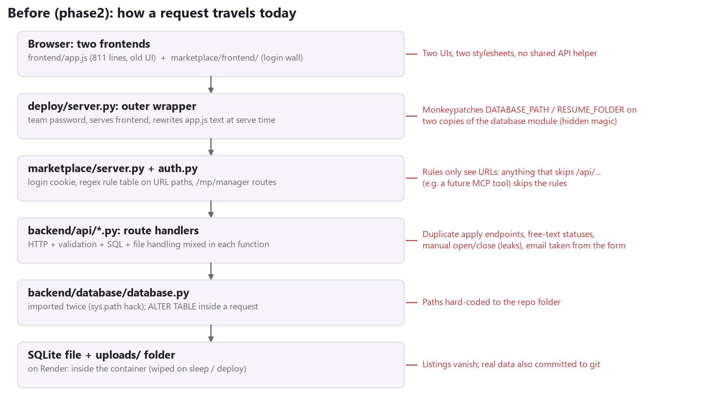
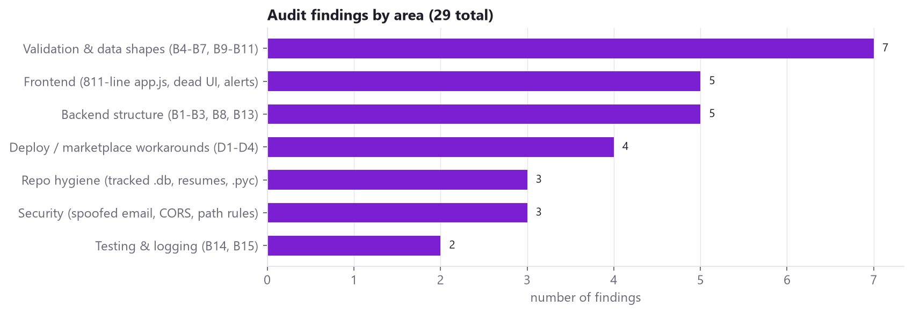
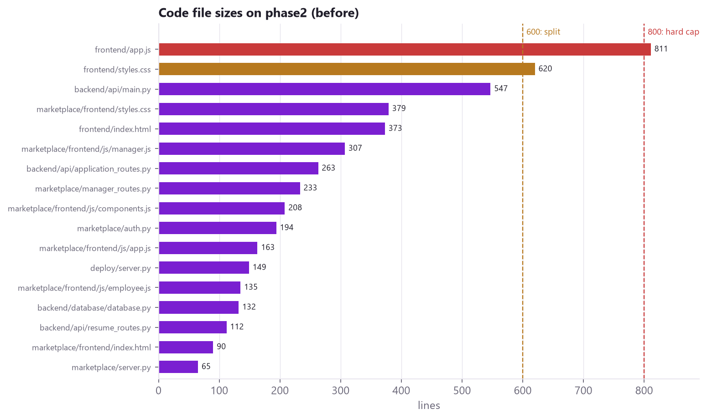
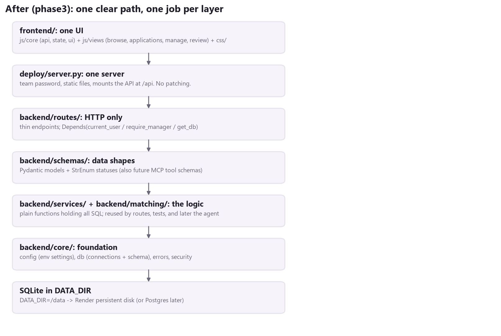

# Net-Worker: Next-Level Audit & Elevation Plan

Branch: `phase3` (investigation only; no application code was changed for this brief).
Audience: the Net-Worker team and team lead. Scope: everything tracked in the repo on `phase2`, plus `main`.

---

## 0. Read this first: corrections to our assumptions

| Assumption | What the repo actually shows |
|---|---|
| "We have an MCP server in the backend." | **There is no MCP server on any branch** (`main`, `phase2`, `deploy/container-round1`). Nothing imports an MCP library, and nothing in the code mentions MCP. If someone has one locally, push it to a branch before we plan around it. Otherwise it is new work, and Section 4 covers how to build it on top of what we have. |
| "One frontend." | There are **two**. `frontend/` is the original ProjectHub page. `marketplace/frontend/` is the login-wall version that Render now serves. They share no code, and each has its own `styles.css`. |
| "Files are under the cap." | `frontend/app.js` is **811 lines** (over 800). `frontend/styles.css` is **620** (over the 600 split line). Two folders are already at the 4-file limit (`marketplace/`, `marketplace/frontend/js/`), so anything new needs a new folder. |
| "Private data stays private." | `backend/database/projecthub.db`, three real resumes in `uploads/resumes/`, and four `__pycache__/*.pyc` files are still **tracked in git**. `.gitignore` only stops *new* ones. |

**Team rule to respect:** most fixes in Section 1 touch the group's original `backend/` and `frontend/` files. Until now we've worked additive-only. That is why all of this happens on the **`phase3` branch**: the team can review the result side by side with `phase2`/`main` and decide what to merge. Nothing on `main` changes.

### Visual summary









---

## 1. Syntax & architecture level-up

### 1.1 What looks fragile or "vibe-coded" today

**Backend: `backend/`**

| # | Where | Problem | Why it matters in a demo / code walk |
|---|---|---|---|
| B1 | [main.py:19-23](../backend/api/main.py#L19-L23) | `sys.path.append(...)` then `from database import ...`. The same file is also imported as `backend.database.database` elsewhere, so Python loads **two copies** of the database module. | Nobody can explain this out loud without a whiteboard. It is also why [deploy/server.py:53-58](../deploy/server.py#L53-L58) has to patch both copies. |
| B2 | [resume_routes.py:12-13](../backend/api/resume_routes.py#L12-L13), [database.py:8](../backend/database/database.py#L8) | Paths are hard-coded to the repo folder, and the uploads folder is created at *import time*. | There is no configuration layer, so deploy has to monkeypatch module globals ([deploy/server.py:57-61](../deploy/server.py#L57-L61)). That is hidden magic. |
| B3 | main.py: every route | `connection = get_connection()` ... `connection.close()` written by hand in each handler. In [upload_projects_csv](../backend/api/main.py#L256-L299) and [update_application_status](../backend/api/main.py#L522-L541), an error halfway through skips `close()`. | Connections leak, and the same 6 lines of boilerplate repeat 9 times. |
| B4 | [main.py:163](../backend/api/main.py#L163), [:377](../backend/api/main.py#L377), [application_routes.py:62](../backend/api/application_routes.py#L62), [main.py:507](../backend/api/main.py#L507) | Statuses are free text checked with `LOWER(TRIM(status)) = 'open'`, and the allowed list is written inline in one handler. | "Open" / "open " / "OPEN" are all different values in the database. There is no single source of truth. |
| B5 | [main.py:319](../backend/api/main.py#L319) vs [application_routes.py:34](../backend/api/application_routes.py#L34) | **Two "apply" endpoints** with copy-pasted employee-upsert logic. The JSON one upserts the employee *before* checking the project is open. | Two code paths for one job will drift apart. |
| B6 | [main.py:378](../backend/api/main.py#L378) | `getattr(application, "project_id", None)` on a Pydantic model that always has `project_id`. | A classic AI-generated defensive tic. Use `application.project_id`. |
| B7 | [application_routes.py:91-92](../backend/api/application_routes.py#L91-L92) | `employee["resume_filename"] or "" if employee else ""` | It is correct, but only if you know Python's operator precedence. Write it as an `if` block. |
| B8 | [application_routes.py:20-31](../backend/api/application_routes.py#L20-L31) | Runs `ALTER TABLE` **inside a request handler**. | Schema changes belong in `create_tables()` / startup, not in every apply request. |
| B9 | [application_routes.py:49](../backend/api/application_routes.py#L49) vs [main.py:124](../backend/api/main.py#L124) | Email is checked with `"@" in email` in one place and `EmailStr` in the other. | Inconsistent validation. |
| B10 | [application_routes.py:98-134](../backend/api/application_routes.py#L98-L134) vs [resume_routes.py:49-87](../backend/api/resume_routes.py#L49-L87) | Resume validation (extension, 5 MB, magic bytes) is duplicated. The 5 MB value is a constant in one file and a magic number in the other. | Extract one `read_valid_resume(upload) -> (bytes, extension)` function. |
| B11 | All GET routes | `SELECT *` then `dict(row)`, with no `response_model`. `GET /projects/{id}/applications` returns every column, including internal ones. | The API contract is whatever the table happens to contain. Pydantic response models fix this and document it. |
| B12 | [main.py:30-36](../backend/api/main.py#L30-L36) | CORS `allow_origins=["*"]` together with `allow_credentials=True`. | Now that we have login cookies, restrict this to our own origin. |
| B13 | [main.py:39](../backend/api/main.py#L39) | `@app.on_event("startup")` is deprecated in FastAPI. | Use a `lifespan` function (deploy already does). |
| B14 | `resumes/upload` | Saves a file that nothing ever links to (orphan files). | Delete it, or tie it to an employee. |
| B15 | whole repo | No tests. `print()` instead of `logging`. | Leadership will ask "how do you know it works?" |

**Security gap (fix before the demo).** [application_routes.py:34-44](../backend/api/application_routes.py#L34-L44) takes `name` and `email` from the **form**. The marketplace UI makes the email field read-only, but the server never checks it against the logged-in user. So any signed-in employee can apply *as someone else* by sending their own request. Identity must come from the session, not the request body (see 1.2c).

**Our own deploy/marketplace code (be honest about it too)**

| # | Where | Problem |
|---|---|---|
| D1 | [deploy/server.py:53-61](../deploy/server.py#L53-L61), [:139-145](../deploy/server.py#L139-L145) | Monkeypatches `DATABASE_PATH` / `RESUME_FOLDER` and rewrites `app.js` with a string replace. This was the only way to stay additive-only, but it is exactly the "hidden magic" the lead doesn't want. It disappears once B1/B2 are fixed. |
| D2 | [marketplace/auth.py:116-136](../marketplace/auth.py#L116-L136) | Access rules are regexes on **URL paths**, run in middleware. Anything that reaches the data without going through those URLs (for example a future MCP tool) skips the rules. They need to move into FastAPI dependencies (see 1.2c and Section 4). |
| D3 | [marketplace/manager_routes.py](../marketplace/manager_routes.py) | Uses a `marketplace_listings` side table and reaches into `resume_routes.RESUME_FOLDER` at request time, both to avoid touching `backend/`. Once we may edit `backend/`, the "posted by" columns belong on `projects` itself. |
| D4 | [marketplace/auth.py:48](../marketplace/auth.py#L48) | Sessions are kept in a Python dict, so everyone is signed out on every restart. That is fine until SSO, but it should be documented as temporary. |

**Frontend: `frontend/app.js` (811 lines)**

- **Over the line cap.** It has to be split.
- **API address.** [Line 2](../frontend/app.js#L2) hard-codes `http://127.0.0.1:8000`; deploy rewrites it at serve time.
- **No shared API helper.** 9 separate `fetch` calls each repeat their own error handling (`if (!response.ok) throw ...`).
- **State and errors.** Global mutable state (`availableProjects`, `selectedProject`), `alert()` for errors, and `setTimeout` to close a modal.
- **Dead UI.** [Lines 447-474](../frontend/app.js#L447-L474): the profile's resume picker shows a file name but never uploads anything. The manager stat card shows the literal text "Not available" ([line 568](../frontend/app.js#L568)).
- **Inline colors.** [Line 34](../frontend/app.js#L34) sets inline colors (`element.style.color = "#c0392b"`) instead of CSS classes.

### 1.2 The intermediate-level target (clean, explainable, under 800 lines per file)

**Proposed backend layout.** Every folder has at most 4 files, and every file has one job:

```
backend/
  core/          config.py     settings from environment variables (DATA_DIR, origins, login mode)
                 db.py         get_db() dependency + create_tables()
                 errors.py     NotFound / Conflict / Invalid, mapped to 404 / 409 / 400 once
                 security.py   current_user / require_manager dependencies
  schemas/       projects.py   Pydantic models: ProjectIn, ProjectOut, ProjectStatus
                 applications.py
                 users.py
                 insights.py   match scores + activity feed shapes
  services/      projects.py   plain functions holding the SQL, e.g. list_open(db)
                 applications.py
                 resumes.py    read_valid_resume(), extract_text()
                 activity.py   the activity_events log (Section 3.2 / 3.3)
  matching/      skill_match.py  skill-match scoring (Section 3.1)
  routes/        projects.py   thin endpoints: validate -> call service -> return schema
                 applications.py   (manager endpoints sit beside the others,
                 auth.py            guarded by Depends(require_manager))
                 insights.py
  app.py         create the FastAPI app, include routers, map errors
```

The rule everyone can say out loud: **routes talk HTTP, services talk SQL, schemas define the shapes.** The future MCP server calls the same services (Section 4).

**a) Settings in one place** (replaces B2 and D1)

```python
# backend/core/config.py
from pathlib import Path
import os

DATA_DIR = Path(os.getenv("DATA_DIR", "deploy/.localdata"))
DATABASE_PATH = DATA_DIR / "projecthub.db"
RESUME_DIR = DATA_DIR / "resumes"
ALLOWED_ORIGINS = os.getenv("ALLOWED_ORIGINS", "http://localhost:8000").split(",")
```

**b) One database dependency** (replaces B1 and B3)

```python
# backend/core/db.py
def get_db():
    connection = sqlite3.connect(config.DATABASE_PATH)
    connection.row_factory = sqlite3.Row
    connection.execute("PRAGMA foreign_keys = ON")
    try:
        yield connection          # FastAPI hands this to the route
    finally:
        connection.close()        # always runs, even on errors
```

**c) Identity as an explicit dependency** (replaces D2 and fixes the security gap)

```python
# backend/core/security.py
def current_user(request: Request) -> User:
    user = sessions.lookup(request.cookies.get(COOKIE_NAME))
    if user is None:
        raise HTTPException(401, "Please log in first.")
    return user

def require_manager(user: User = Depends(current_user)) -> User:
    if user.role != "manager":
        raise HTTPException(403, "Project managers only.")
    return user
```

**d) Strict schemas with one list of statuses** (replaces B4, B9 and B11)

```python
# backend/schemas/applications.py
from enum import StrEnum

class ApplicationStatus(StrEnum):
    SUBMITTED = "Submitted"
    UNDER_REVIEW = "Under Review"
    ACCEPTED = "Accepted"
    REJECTED = "Rejected"

class ApplicationOut(BaseModel):
    id: int
    project_id: int
    project_title: str
    status: ApplicationStatus
    submitted_at: datetime
```

**e) Thin routes.** Each one reads like a sentence:

```python
# backend/routes/applications.py
@router.post("/", response_model=ApplicationOut, status_code=201)
async def apply(
    project_id: int = Form(...),
    cover_letter: str = Form(""),
    resume: UploadFile | None = File(None),
    user: User = Depends(current_user),          # identity from the session, not the form
    db: sqlite3.Connection = Depends(get_db),
):
    resume_file = await resumes.read_valid_resume(resume) if resume else None
    return applications.submit(db, user, project_id, cover_letter, resume_file)
```

> Note: with SQLite's blocking driver, keep `def` (sync) routes for pure-database work. FastAPI runs them in a thread pool. Use `async def` only where we `await` something, such as reading an upload. Mixing them up blocks the server, and it is a common review question.

**f) Frontend.** One API client, and one file per view. Keep it vanilla JS so everyone can read it.

```
marketplace/frontend/js/
  core/   api.js        apiGet / apiSend / apiUpload with shared 401 + error handling
          state.js      the current user and the selected listing, in one object
          ui.js         badge(), skeleton(), toast(), emptyState()
  views/  browse.js  applications.js  manage.js  review.js
  app.js                router + login wall
```

`marketplace/frontend/js/components.js` already has `apiFetch`/`sendJSON`. We promote and extend those rather than starting over. The original `frontend/` should be **retired** once the team agrees the marketplace UI replaces it. That one decision removes the 811-line file, the 620-line stylesheet and the `app.js` rewrite hack together.

---

## 2. De-vibe-coding the GUI (keeping the purple)

### 2.1 What reads as "AI prototype" today

Observed in [frontend/styles.css](../frontend/styles.css), [marketplace/frontend/styles.css](../marketplace/frontend/styles.css) and the screenshots in `docs/architecture_audit/login_wall_screens/`:

1. **Glow and gradient everywhere.** Examples:
   - The radial purple background ([styles.css:37](../frontend/styles.css#L37)).
   - Gradient *text* on the logo ([:73](../frontend/styles.css#L73)).
   - Gradient buttons with a glow shadow (`--glow`, [:212-225](../frontend/styles.css#L212-L225)).
   - Gradient card backgrounds ([:259](../frontend/styles.css#L259), [:306](../frontend/styles.css#L306)).

   Enterprise tools (Teams, Linear) use flat surfaces and save color for meaning.
2. **Ten identical, fully saturated "Apply" buttons per screen.** Every card has two equally heavy buttons, so nothing stands out. The eye has no place to land.
3. **Everything is the same size.** Card titles, metadata and chips are all close to the same weight. The 11px skill chips and seniority pills are hard to read.
4. **Status is just text.** "Open", "Under Review" and the "Saved: Under Review." line are plain words or colored text. There is no consistent badge system with a color meaning per status.
5. **No loading, empty or error design.** Today we show "Loading..." text, `<p>No projects found.</p>`, `alert()`, and red status lines.
6. **Native controls.** Browser-default `<select>` for picking a listing and for application status; the browser's own PDF toolbar inside the viewer.
7. **The review screen is cramped and unbalanced.** The listing dropdown sits on top, a single applicant floats in empty space, and metadata plus the status dropdown are squeezed between the list and the PDF.
8. **Two stylesheets, two sets of tokens.** Spacing and radius values drift between `frontend/` and `marketplace/frontend/`.

### 2.2 Upgrades (specific, all doable in plain CSS + vanilla JS)

**Design tokens: one `tokens.css`**
- Keep accent `#A100FF`, but use it only for primary actions, focus rings and the active nav item.
- Neutral surfaces: `--surface-0/1/2` with **flat** fills, 1px borders, and no glows or gradients.
- **Light theme by default** (Teams-like), with the existing dark palette as `[data-theme="dark"]`. Leadership demos on projectors look better in light mode.
- Spacing scale on a 4px grid (`--space-1 … --space-8`). Radius: 6px for controls, 10px for cards. One type scale: 12 / 13 / 14 / 16 / 20 / 28.
- Keep "Segoe UI" (it is Teams' own font). Add `font-variant-numeric: tabular-nums` to counts and dates.

**Layout: Teams-style app shell**
- **Left rail** (56px, icons + labels) for the main sections, instead of the top text tabs.
- **Top bar:** search on the left; user chip and **role badge** on the right.
- **Role-switching state:** a clear, permanent role chip ("Employee" in neutral / "Project Manager" in purple), plus a subtle 2px accent line on the top bar in manager mode, so the audience always knows which view they are in. The manager rail shows extra items (Post, Manage, Review), and the employee rail never shows disabled ones.

**Listing cards**
- The whole card is clickable and opens a **detail drawer** on the right. There is one primary action ("Apply"), shown inside the drawer or on hover; the second button goes away.
- Card hierarchy:
  1. Title (16px semibold).
  2. Client (13px muted).
  3. Skill chips (12px, max 4, then a "+2").
  4. A footer row with location · seniority · **status badge** · applicant count (manager only).

**One badge component, one color map:**

| Status | Badge |
|---|---|
| Open | green |
| Closed | grey |
| Filled | blue |
| Submitted | grey |
| Under Review | amber |
| Accepted | green |
| Rejected | red |

**States**
- **Skeleton cards** (a shimmering grey card shape) while the feed loads, in place of "Loading...".
- **Empty states** with a one-line explanation and an action ("No applicants yet. Share this listing").
- **Toasts** (bottom-right, auto-dismiss) in place of `alert()` and colored status lines.
- **Optimistic status changes:** the badge updates instantly and rolls back with a toast if the server refuses.

**Review screen: split-pane document viewer tied to the listing**

```
+--------------------+-------------------------------------------+------------------+
| Listing: Backend   |                                           | Erin Employee    |
| Engineer  [Open]   |            PDF (fit to width)             | [Under Review]   |
| 3 applicants       |                                           | Match 83%        |
|--------------------|                                           | Python FastAPI   |
| > Erin   [Review]  |                                           | SQL  (matched)   |
|   Sam    [New]     |                                           | Cover letter...  |
|   Priya  [Accept]  |                                           | [Accept][Reject] |
+--------------------+-------------------------------------------+------------------+
```

- The **left** pane is the listing header plus the applicant list with status badges. The listing is picked from a searchable list, not a `<select>`.
- The **centre** is the PDF, which gets the most space. Use `src="...#toolbar=0&view=FitH"` to hide the browser chrome in Edge/Chrome. DOCX shows extracted text in a document-styled card.
- The **right** pane shows applicant details, matched skills highlighted, the cover letter, and **Accept / Reject / Under review buttons** in place of a dropdown.
- Keyboard: `J`/`K` for next/previous applicant, `A`/`R` to accept/reject. It is small to build and impressive live.

**Motion:** 150ms transitions on `background-color`, `border-color` and `transform` only (today it is `transition: 0.25s ease` on everything). Respect `prefers-reduced-motion`.

---

## 3. Leadership demo tricks: high ROI, low complexity

Each of these is under about 150 lines across backend and frontend and reuses data we already store.

### 3.1 Instant skill-match score (the headline feature)

- **What they see:** every listing card shows "**83% match**". Clicking it shows which skills matched (green) and which are missing (grey). Employees get a "Best matches for you" sort, and managers see applicants ranked by match.
- **Why it's cheap:**
  - We already store `projects.required_skills`, `employees.skills` and `employees.resume_text` (extracted from the PDF/DOCX at upload).
  - The `matches` table already exists in [database.py](../backend/database/database.py) and is **unused**.
  - The old frontend already has `calculateMatch()` ([app.js:480](../frontend/app.js#L480)), but in the browser and on session-only skills.
- **Build:** `matching/skill_match.py` (pure Python, about 60 lines: normalise skills, look for each required skill in the employee's skills + resume text, score = matched / required) and one endpoint, `GET /api/insights/matches`. It is explainable line by line, with no ML, and it is the natural first tool for the agent later.

### 3.2 Application status tracker (real-time feel, no websockets)

- **What they see:** the employee's "My applications" shows a **stepper**: Submitted → Under Review → Accepted/Rejected, with timestamps. When the manager clicks Accept on the other laptop, the employee's stepper moves within a few seconds.
- **Build:**
  - A new `application_events(id, application_id, actor_email, from_status, to_status, created_at)` table, written by the status-change service.
  - The frontend polls `GET /api/applications/mine?since=<timestamp>` every 10 seconds while the tab is visible.
  - Polling is a deliberate, explainable choice over websockets.

### 3.3 Live activity feed (manager home)

- **What they see:** "Erin applied to Backend Engineer · 2 min ago", "Sam was accepted to QA Tester · just now", plus pipeline counters per listing (New 3 · Reviewing 2 · Accepted 1).
- **Build:** it reads the **same** `application_events` table as 3.2. One table powers two features, which makes a good "we designed for reuse" talking point.

### 3.4 One-click proposal preview + "Post from CSV" (already half-built)

- **What they see:** click an applicant and their PDF opens next to the listing instantly (we have this; it needs the 2.2 polish). For managers, drag-drop a CSV onto "Post projects" and see a **preview table with recognised columns ticked** before importing.
- **Build:** the CSV column-alias logic already exists ([main.py:48-114](../backend/api/main.py#L48-L114)). Add a `dry_run=true` flag that returns the parsed rows without inserting, then render them as a table.

### Demo blocker: data must survive

Listings and applications currently vanish when Render's free tier sleeps (see `docs/listing_persistence_walkthrough.md`). Before any leadership demo, either attach a Render persistent disk at `/data` (paid, zero code change) or move to hosted Postgres. Otherwise the activity feed and tracker reset mid-presentation.

---

## 4. Pre-agent readiness check

**Target shape** (the agent is the middle tier; it never touches SQL directly):

```
Browser --(cookie)--> FastAPI routes ----------------------+
   |                                                       v
   +--> /api/agent/chat --> Agent (LLM + tool loop) --> MCP server --> services/ --> SQLite
                              acts AS the logged-in user     (tools)    (same functions the
                                                                         REST routes use)
```

**Prep to do now**, in order. Each item is small, and each removes a source of friction later:

1. **Build the service layer first** (1.2). REST routes and MCP tools must call the *same* `services/*.py` functions. If the SQL stays inside route handlers, the MCP server will copy it, and we'll have three versions of "apply to a project".
2. **Move access control out of URL-path middleware** into `current_user` / `require_manager` dependencies, and pass the `User` into services. Services check ownership, for example "employees only see their own applications". MCP tool calls never go through `/api/...` URLs, so path-based rules (D2) would be **silently bypassed**. This is the biggest security risk in the agent plan.
3. **Pydantic schemas become tool schemas for free.** MCP tools describe their inputs and outputs as JSON Schema, and `ProjectOut.model_json_schema()` gives us that directly. Typed schemas now mean zero hand-written tool definitions later.
4. **Make identity and statuses explicit in the data:**
   - `ApplicationStatus` / `ProjectStatus` enums (B4).
   - An `actor` column on `application_events`, so we can show "changed by Morgan" vs "changed by agent on behalf of Morgan". Leadership *will* ask "what did the AI do?", and the events table answers it.
5. **Persistent storage** (Section 3 blocker). An agent that forgets what it posted on every restart is a bad demo.
6. **One settings module** (1.2a). The agent's API key goes in a Render environment variable that `config.py` reads, never in git. Add `ANTHROPIC_API_KEY` (or whichever provider) to the documented env list now.
7. **Reserve the seams:**
   - Backend: a `backend/agent/` folder (`agent.py`, `tools.py`, `prompts.py`) and a `backend/mcp/` folder (`server.py`).
   - Routes: an `/api/agent/*` route prefix.
   - Frontend: a `views/assistant.js` slot. `marketplace/frontend/js/` is already at 4 files, so the restructure in 1.2f must happen first.
8. **Start the agent read-only:** `search_listings`, `get_match_scores`, `summarise_applicant`. Write tools (`post_listing`, `change_status`) come second and always need a confirm click in the UI. That is easy to explain and safe to demo.
9. **Add a small pytest suite over `services/`**, about 10 tests: apply, duplicate apply, closed project, status change, match score. These are what tell us an agent-driven change didn't break anything.
10. **Clean the repo (needs team sign-off):** `git rm --cached` the `.db`, the `uploads/resumes/*` and the `__pycache__/*.pyc`. Then pick one frontend (the marketplace) and retire `frontend/`.

---

## 5. Top 5 moves, in execution order

| # | Move | Fixes | Size | Needs sign-off |
|---|---|---|---|---|
| 1 | **Foundation:** `core/config.py` + `core/db.py` (`get_db` dependency), one import path, lifespan startup, schema upgrades at startup | B1, B2, B8, B13, D1 | S | Yes (edits `backend/`) |
| 2 | **Schemas + services:** Pydantic in/out models, status enums, SQL moved into `services/`, routes made thin on get_db, one apply endpoint | B3-B7, B9-B11, readiness 1 & 3 | M | Yes |
| 3 | **Identity as dependencies:** `current_user` / `require_manager`; apply uses the session email (closes the spoofing gap); restrict CORS | Security gap, B12, D2, readiness 2 | S | Yes |
| 4 | **Data that survives + events table:** persistent disk or Postgres; `application_events` | Demo blocker, readiness 4 & 5, enables 3.2 / 3.3 | S-M | Yes (cost or infra) |
| 5 | **UI pass + headline features:** tokens/light theme, badges, skeletons, toasts, 3-pane review, then skill-match score and status tracker | Section 2, 3.1, 3.2 | M-L | No (marketplace UI is ours) |

Moves 1 to 3 are one focused refactor of about 600 lines moved (not added) across `backend/`. After them, every file is small, every data path can be explained in one sentence, and the MCP server becomes a thin wrapper over `services/`.
