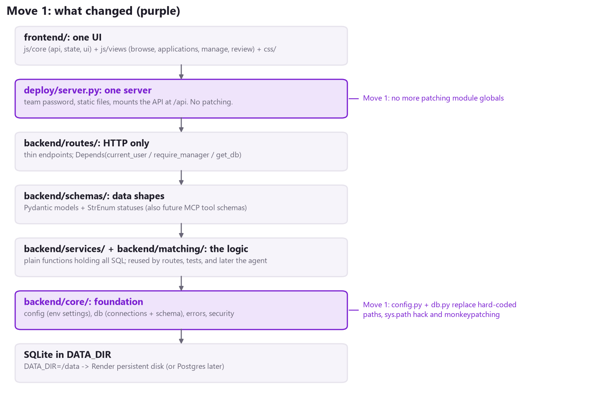
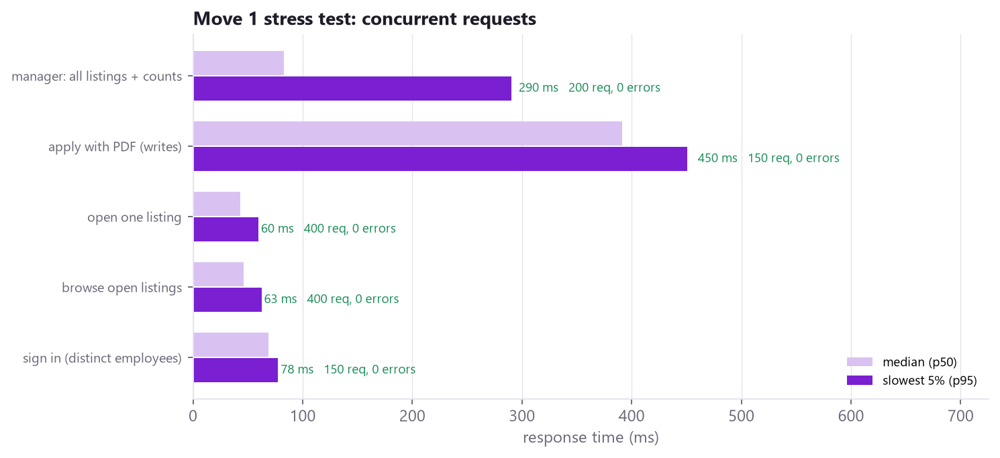

# Phase 3 - Move 1: The Foundation (backend/core/)

Branch: `phase3`. Folder walked through: `backend/core/`. Audit findings fixed: B1, B2, B8, B13, D1.

## 1. In one sentence

Every setting now lives in **one file** (`config.py`), and every database connection is made in **one file** (`db.py`). Before, these were scattered and partly hidden, and the server had to "patch" other modules at startup.



## 2. Why this move came first

Everything else (services, security, the future agent) needs to answer two questions: *where is the data?* and *how do I talk to the database?* Before Move 1, those answers were:

- **Where is the data?** Hard-coded to the repo folder in two places (`backend/database/database.py` and `backend/api/resume_routes.py`). On Render, `deploy/server.py` overwrote those values at startup ("monkeypatching").
- **How do I talk to the database?** `backend/api/main.py` added a folder to `sys.path` and imported the database file by a short name. Other files imported it by its full name, so Python loaded **two copies** of the same module, and the deploy code had to patch both.

Nobody could explain that out loud without a whiteboard. Now the answers are `config.DATA_DIR` and `db.connect()` / `db.get_db()`.

## 3. Files touched

| File | Change | Lines |
|---|---|---|
| backend/core/config.py | **New.** All settings, read from environment variables | 48 |
| backend/core/db.py | **New.** connect(), get_db(), create_tables() + upgrades for old database files | 155 |
| backend/database/database.py | **Deleted.** Its job moved into core/db.py | -132 |
| backend/api/main.py | Removed the sys.path hack; startup uses lifespan instead of the deprecated on_event | small |
| backend/api/resume_routes.py | Uses config.RESUME_DIR and config.MAX_RESUME_BYTES; no folder creation at import | small |
| backend/api/application_routes.py | Same settings; no more ALTER TABLE inside a request | small |
| marketplace/manager_routes.py | "Posted by" now stored on the projects table, not a side table | small |
| deploy/server.py | The whole "patch the modules" section is gone; reads config | -25 |
| deploy/Dockerfile, deploy/marketplace/Dockerfile | Copy backend/core/ instead of database.py | 1 each |
| tests/conftest.py, tests/test_core.py, tests/stress/load_test.py | **New.** Tests and the load tester | new |

The tracked file backend/database/projecthub.db was **not** touched (private data needs team sign-off first). The app no longer reads it: by default data now lives in `.localdata/` (git-ignored) locally and `/data` in the container.

## 4. Walkthrough: backend/core/config.py

Read top to bottom, it answers "what can I configure?"

| Setting | Comes from | Default | Used by |
|---|---|---|---|
| DATA_DIR | env DATA_DIR | repo/.localdata | everything that stores data |
| DATABASE_PATH | DATA_DIR + projecthub.db | - | db.connect() |
| RESUME_DIR | DATA_DIR + resumes | - | resume upload, document viewer |
| MAX_RESUME_BYTES | fixed | 5 MB | both upload endpoints |
| TEAM_USERNAME / TEAM_PASSWORD | env APP_USERNAME / APP_PASSWORD | team / empty | deploy/server.py password gate |
| ALLOW_NO_PASSWORD | env ALLOW_NO_AUTH=1 | off | local runs only |
| DEMO_CSV | fixed | deploy/demo_projects.csv | startup demo data |

The rule to say out loud: **nothing else calls os.getenv().** If you want to know what the app reads from the environment, this file is the complete list.

Other modules read settings as `config.DATABASE_PATH` (module dot name), not `from config import DATABASE_PATH`. That way the value is looked up when it is used, which is what lets tests point the app at a temporary folder.

## 5. Walkthrough: backend/core/db.py

```
connect()        -> a new connection, rows behave like dicts, foreign keys on
get_db()         -> FastAPI dependency: open, hand to the route, ALWAYS close
TABLES           -> the CREATE TABLE statements (same columns as before, plus 3)
ADDED_COLUMNS    -> columns newer than the first version of the database
create_tables()  -> run at startup: WAL mode, tables, missing columns, old data copied
```

**connect()** sets two options worth explaining:

- `check_same_thread=False`: FastAPI can open the connection in one worker thread and run the route in another. Each request still has its own connection, so this is safe.
- `timeout=10`: if another request is writing, wait up to 10 seconds instead of failing straight away with "database is locked".

**get_db()** is a generator with `try / finally`. FastAPI runs everything before `yield` before the route, and the `finally` block after it, *even if the route raised an error*. Routes never call `close()` themselves. (Move 2 moves every route onto it; in Move 1 the old route files still open connections by hand through `connect()`.)

**create_tables()** can run any number of times:

1. Turns on **WAL** journal mode. Readers keep reading while one request writes, which matters as soon as several people use the site at once.
2. Creates any missing table.
3. Adds columns that older database files don't have yet (`employees.resume_text`, `projects.posted_by_email`, `projects.posted_by_name`). Before, `resume_text` was added *inside the apply request* the first time someone applied.
4. Copies "who posted this listing" from the phase-2 side table `marketplace_listings` onto `projects`.

## 6. How a request uses the foundation now

1. Render starts `deploy/server.py`. Its lifespan calls `create_tables()` and loads the 10 demo projects if the database is empty.
2. A request for `/api/projects` reaches the route, which calls `connect()`. The database path comes from `config.DATABASE_PATH`, which comes from `DATA_DIR=/data` in the Dockerfile.
3. There is no patching step anywhere. If you change `DATA_DIR`, everything follows.

**Before / after in deploy/server.py:**

```
BEFORE  import backend.database.database as database_module
        database_copies = [database_module, sys.modules["database"]]
        for module in database_copies:
            module.DATABASE_PATH = DATA_DIR / "projecthub.db"
        for module in [resume_routes, application_routes]:
            module.RESUME_FOLDER = RESUME_DIR

AFTER   from backend.core import config
        from backend.core.db import connect, create_tables
```

## 7. Tests (tests/test_core.py): 7 passed

| Test | What it proves |
|---|---|
| test_settings_come_from_environment | DATA_DIR from the environment changes the database path |
| test_create_tables_is_safe_to_repeat | 3 runs in a row; all tables exist; WAL mode on; resume folder created |
| test_old_database_file_is_upgraded | A phase-2 database gains the new columns and keeps "posted by" |
| test_get_db_closes_connection_even_on_error | After a route crash, the connection is closed |
| test_database_module_loaded_once | No stray second copy of the database module |
| test_resume_upload_lands_in_data_dir | Upload through the real server lands in DATA_DIR/resumes |
| test_many_writers_at_once | 20 threads x 25 inserts at once: 500 rows, 0 "database is locked" errors |

Run them: `python -m pytest -q`

## 8. Stress test (tests/stress/load_test.py)

The load tester starts the **real server** (team password on, empty data folder), signs in 150 different employees and one manager, then sends requests 25 at a time.



- **1,300 requests, 0 errors.** Reads stay under about 65 ms for the slowest 5%.
- **Finding for Move 2:** "apply with PDF" takes about 390 ms. The apply endpoint is `async def`, but it reads the PDF and writes to SQLite with blocking calls. In an `async` route that blocks the whole server loop, so concurrent applies wait in line. Move 2 fixes this and re-measures.

Run it: `python tests/stress/load_test.py --move move1`

## 9. Honest notes

- **Bridge code.** The old route files import `connect as get_connection`, so their bodies did not have to change in this move. Move 2 replaces those files entirely and the alias disappears.
- **New default data location.** Locally the database now lives in `.localdata/projecthub.db`. The committed `backend/database/projecthub.db` is ignored by the app but still tracked in git, pending team sign-off.
- **Render.** Nothing changes on the live site unless Render is pointed at the `phase3` branch.
