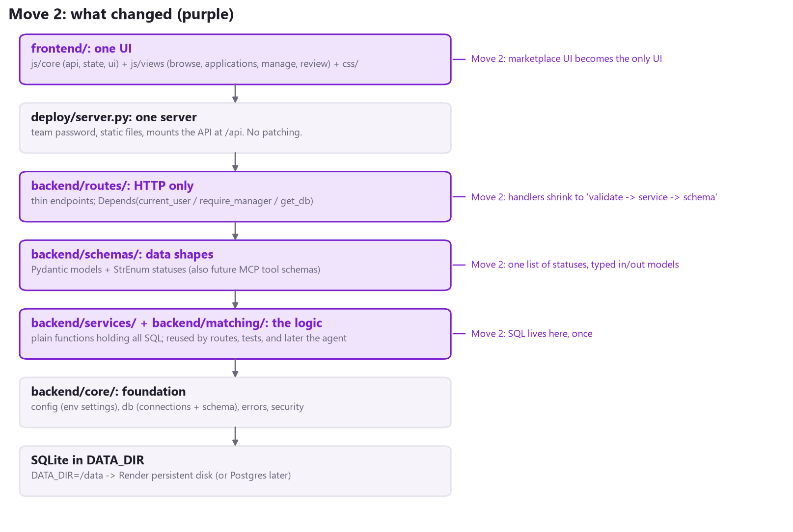
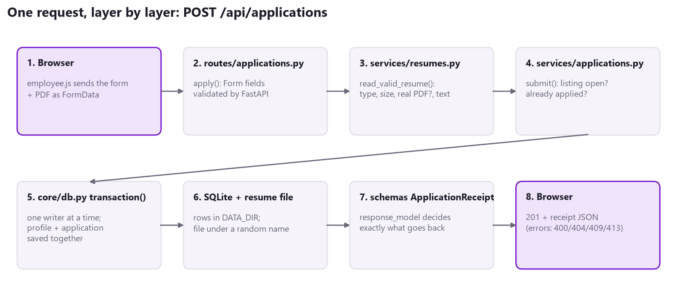
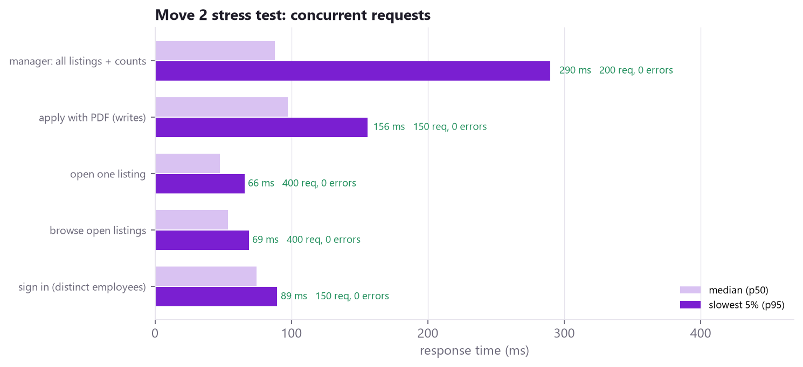
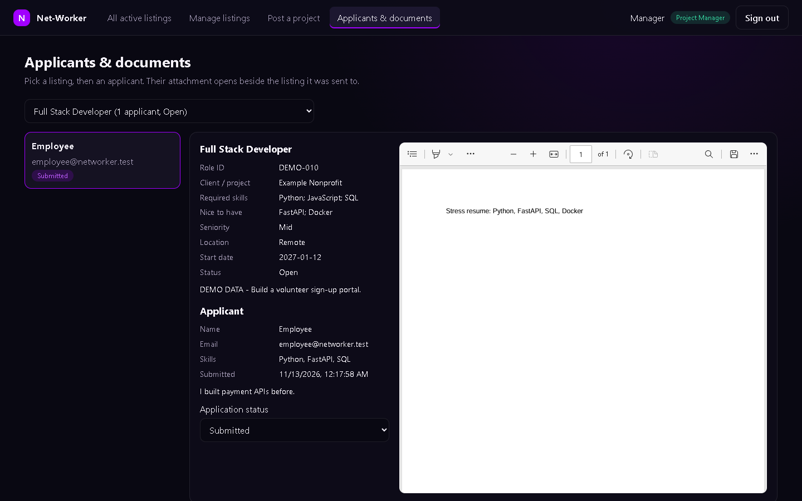

# Phase 3 - Move 2: Schemas, Services, Thin Routes, One Server

Branch: `phase3`. Folders walked through: `backend/schemas/`, `backend/services/`, `backend/routes/`, plus `backend/app.py`, `deploy/server.py` and `frontend/`. Audit findings fixed: B3, B4, B5, B6, B7, B9, B10, B11, B14, D3, and the 811-line `frontend/app.js`.

## 1. In one sentence

Every backend file now has **one job**. **Routes** talk HTTP, **services** talk SQL, and **schemas** define the shapes, so anyone can answer "where does X happen?" by looking at the folder name.



## 2. The rule to say out loud

| Layer | Folder | Knows about | Never does |
|---|---|---|---|
| Routes | backend/routes/ | HTTP: paths, forms, status codes, cookies | SQL |
| Schemas | backend/schemas/ | What data looks like going in and out | Logic |
| Services | backend/services/ | SQL, files, business rules | HTTP (no Request, no status codes) |
| Core | backend/core/ | Settings, connections, errors, sessions | Feature logic |

Because services don't know about HTTP, they can be called from **anywhere**: a route, a test, a startup script, and later the MCP server. Tests in this move call them directly, with no web server involved.

## 3. One request, layer by layer



## 4. Walkthrough: backend/schemas/ (data shapes)

| File | What is inside | Why it matters |
|---|---|---|
| projects.py | ProjectStatus (Open/Closed/Filled), ProjectIn, ProjectOut, ManagedProjectOut, ProjectStatusChange, CsvImportResult | The **only** list of listing statuses. ProjectIn trims spaces and limits lengths, so "  Title  " is saved as "Title". |
| applications.py | ApplicationStatus, ApplicationReceipt, MyApplication, Applicant, ApplicationDocument | The **only** list of application statuses. ApplicationDocument nests the full ProjectOut, so the viewer gets the listing in the same shape everywhere. |
| users.py | Role, User, LoginRequest, LoginResponse | LoginRequest checks the email format once, for every login. |

**StrEnum** is the key idea. `ProjectStatus.OPEN` is a real Python value *and* the plain text "Open". If someone sends `{"status": "Maybe"}`, FastAPI answers **422** before our code even runs.

**response_model** on every route means the schema decides what leaves the server. Before, `SELECT *` sent every column, including internal ones. Now a listing in the feed has exactly the 13 fields of ProjectOut; who posted it stays in the manager-only view.

## 5. Walkthrough: backend/services/ (the logic)

Every function takes the database connection `db` as its first argument and returns plain dicts.

| File | Functions | Notes |
|---|---|---|
| projects.py | list_open, get, list_for_managers, create, set_status, import_csv | The team's CSV column-alias rules are kept as they were, just in one place. Unknown statuses in a CSV are now skipped instead of saved as free text. |
| applications.py | submit, list_for_email, list_for_project, find, get_document, attachment_path, set_status | **One** submit() replaces the two old apply endpoints. A refused or failed apply never leaves a stray resume file behind. |
| resumes.py | read_valid_resume, extract_pdf_text, extract_docx_text, save, delete, path_for, attachment_type | One validation path instead of two copies. path_for() only accepts names we generated, so a database value can never point outside the resume folder. |

**Errors without HTTP.** Services raise `NotFound`, `Conflict`, `Invalid` or `TooLarge` (`backend/core/errors.py`). `backend/app.py` turns them into 404 / 409 / 400 / 413 in **one** handler. There are no `HTTPException(status_code=...)` blocks scattered through the logic.

**Transactions.** Writes go through `with transaction(db):` (`core/db.py`). Everything inside commits together, or rolls back together if anything fails. It also makes writers queue in order (see the stress results below).

## 6. Walkthrough: backend/routes/ (HTTP only)

```
@router.patch("/{project_id}/status", response_model=ProjectOut)
def change_status(project_id: int, change: ProjectStatusChange, db=Depends(get_db)):
    return projects.set_status(db, project_id, change.status)
```

Every route reads like that sentence: **validated input -> one service call -> a schema**. `db=Depends(get_db)` hands the route a connection and always closes it afterwards. That is audit finding B3, which Move 1 started and this move finishes.

**All routes are plain def, not async def.** They do blocking work (SQLite, reading files). FastAPI runs plain `def` routes in a pool of worker threads, so one slow request no longer freezes the server. The old apply endpoint was `async def` with blocking work inside, and the stress test caught it (section 9).

### Endpoint map: old to new

| Before (phase2) | After (phase3) | Who |
|---|---|---|
| GET /api/projects | GET /api/projects | everyone |
| (none) / GET /mp/manager/projects | GET /api/projects/manage | manager |
| POST /mp/manager/projects | POST /api/projects | manager |
| POST /api/projects/upload-csv | POST /api/projects/upload-csv | manager |
| PATCH /mp/manager/projects/{id}/status | PATCH /api/projects/{id}/status | manager |
| GET /api/projects/{id}/applications | GET /api/projects/{id}/applications | manager |
| POST /api/applications and POST /api/applications/submit-with-resume | POST /api/applications (one endpoint) | employee |
| GET /api/applications/my-applications | GET /api/applications/mine | employee |
| GET /mp/manager/applications/{id}/document | GET /api/applications/{id}/document | manager |
| GET /mp/manager/applications/{id}/attachment | GET /api/applications/{id}/attachment | manager |
| PATCH /api/applications/{id}/status | PATCH /api/applications/{id}/status | manager |
| POST /api/resumes/upload, GET /api/applications/{id} | **removed** (unused / replaced by document) | - |
| /mp/auth/* | /api/auth/* | everyone |

## 7. One server, one frontend

- **backend/app.py** (29 lines) collects the routers and maps service errors to HTTP codes.
- **deploy/server.py** is now the only server: team password, login rules, startup (tables + demo data), `/api`, and the frontend. `marketplace/server.py` and the `app.js` text-rewrite trick are gone.
- **frontend/** is now the marketplace UI (login wall + both dashboards). The original `frontend/` (811-line app.js, 620-line stylesheet) is retired on this branch and is still on `phase2` and `main` for comparison. Five fetch paths in the JS changed to the new endpoints.
- **Dockerfile:** one image, `deploy/Dockerfile`, copying `backend/{core,schemas,services,routes}` and `frontend/`. On Render, set Dockerfile Path = `./deploy/Dockerfile` for this branch.

## 8. Tests: 24 passed (17 new in tests/test_services.py)

| Area | What is proven |
|---|---|
| CSV import | Aliases recognised, "open"/"OPEN " normalised, unknown statuses skipped, same file twice adds nothing, empty / wrong columns / non-UTF-8 files refused with clear messages |
| Listings | Feed shows only Open; closing hides a listing; manager view shows poster + counts; old free-text statuses rewritten at startup |
| Resumes | Real PDF and DOCX text extracted; .exe, fake PDF, oversize and broken DOCX refused; stored names can't escape the folder |
| Applications | Duplicate refused **and leaves no orphan file**; closed listing refused; second apply reuses the profile resume; review flow; missing attachment is a 404 |
| Transactions | An error halfway through a write rolls back everything |
| API contract | Feed returns exactly ProjectOut's fields; bad status is a 422; service errors become 404/400 |

## 9. Stress test: the apply fix, measured



| Apply with PDF, 25 at once | p50 | p95 | Requests/second |
|---|---|---|---|
| Move 1 (async route, blocking work inside) | 392 ms | 450 ms | 62 |
| Move 2, plain def routes only | 14 ms | 1,958 ms | 53 |
| Move 2, plain def + transaction() write queue | **97 ms** | **156 ms** | **229** |

How we got there, step by step:

1. Making the route a plain `def` stopped it from blocking the server, so the median dropped from 392 ms to 14 ms.
2. That exposed the next limit. SQLite allows **one writer at a time**, and colliding writers sleep and retry on a timer, which pushed the slowest 5% to about 2 seconds.
3. `transaction()` adds a simple lock so writers queue in order instead of sleeping. The result is 3.7x the throughput of Move 1, with the slowest 5% at 156 ms.

1,300 requests in total, **0 errors**.

**UI walkthrough in Edge (tests/stress/ui_walkthrough.py): 8/8 checks passed.** An employee applies with a PDF, it shows in My applications, the manager opens it inline beside the listing and accepts it, the employee sees "Accepted", and there are no JavaScript errors.



## 10. Honest notes

- **Still the Move 1 security model.** In this move the login rules are still the regex table on URL paths (relocated to `core/security.py`), and the apply endpoint still takes name and email from the form. Move 3 replaces both. That is deliberate, so the Move 3 diff shows the security change on its own.
- **The write lock** works because we run one server process. With several processes, or Postgres later, the database itself handles this and the lock can go.
- **Time zones:** SQLite stores UTC without a marker, so the browser shows submission times in the wrong time zone. Move 5 fixes the display.
