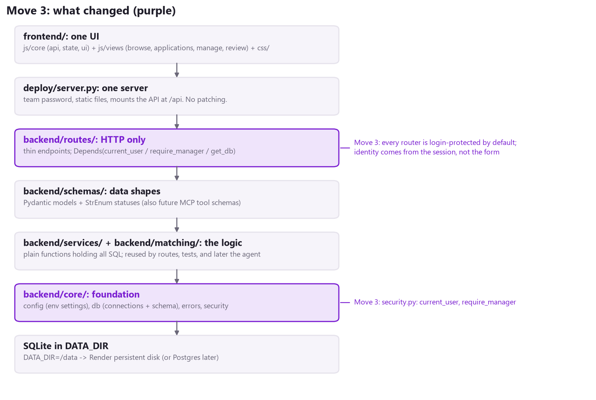
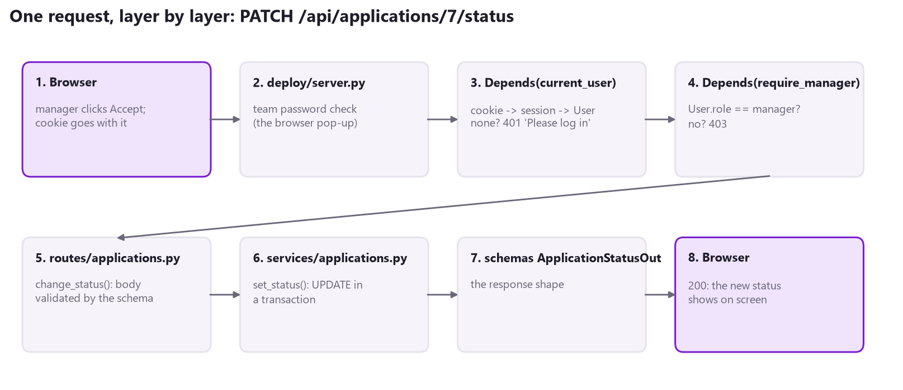
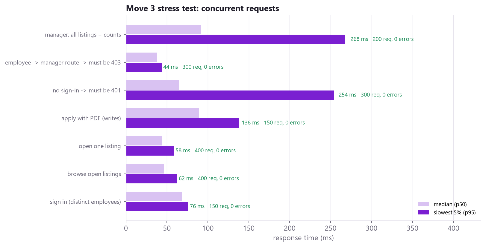

# Phase 3 - Move 3: Identity as Dependencies

Branch: `phase3`. Folders walked through: `backend/core/` (security.py, errors.py), `backend/routes/`, plus `backend/app.py` and `deploy/server.py`. Audit findings fixed: the **email spoofing gap**, B12 (CORS), D2 (URL-path rules), and pre-agent readiness item 2.

## 1. In one sentence

Every route now **says who may call it**, right on the route (`Depends(require_manager)`). Who you are always comes from your **signed-in session**, never from a form field or the URL.



## 2. What was wrong (and why it mattered for the agent)

Before this move, the rules lived in a table of **regular expressions matched against URL paths**, checked by middleware before any route ran:

```
MANAGER_ONLY = [
    ("GET",   r"^/api/projects/manage$"),
    ("PATCH", r"^/api/applications/\d+/status$"),
    ...
]
```

That had three problems:

1. **Forget a line, open a hole.** A new manager route was public until someone remembered to add a regex. Nothing warned you.
2. **Identity from the form.** The apply endpoint took `name` and `email` from form fields. The page made the email box read-only, but anyone sending their own request could apply **as another employee**.
3. **Only URLs were checked.** A future MCP tool calls services directly, not through `/api/...` URLs, so it would have skipped every rule silently.

## 3. One request, layer by layer



## 4. Walkthrough: backend/core/security.py (116 lines)

| Section | What it does |
|---|---|
| 1. Test accounts | Four shared demo logins (not real people). `check_credentials()` is the **one** function to swap for company SSO later. |
| 2. Sessions | `start_session()`, `end_session()`, `get_session_user()`. A random token in an HttpOnly cookie maps to a `User` kept in server memory. |
| 3. Dependencies | `current_user`, `require_manager`, `require_employee`. The regex table and `access_problem()` are **deleted**. |

```
def current_user(request: Request) -> User:
    user = get_session_user(request)
    if user is None:
        raise NotSignedIn("Please log in first.")       # becomes 401
    return user

def require_manager(user: User = Depends(current_user)) -> User:
    if user.role != Role.MANAGER:
        raise Forbidden("This area is for project managers only.")   # becomes 403
    return user
```

**How to read Depends.** FastAPI runs the function in `Depends(...)` *before* the route. If it raises an error, the route never runs. If it returns a value (the `User`), the route receives it as an ordinary argument. `require_manager` itself depends on `current_user`, so "manager" always implies "signed in".

`errors.py` gained `NotSignedIn` (401) and `Forbidden` (403). They are handled by the same single handler in `backend/app.py` as every other error.

## 5. Walkthrough: how routes use it

**Default deny, in backend/app.py.** Every router except login is included with the sign-in dependency:

```
signed_in = [Depends(current_user)]
api.include_router(auth.router)                                   # login must work without a session
api.include_router(projects.router, dependencies=signed_in)
api.include_router(applications.router, dependencies=signed_in)
```

A route someone adds next month is protected **even if they forget**.

**Manager-only routes say so on the route.** When the route needs to know which manager is calling, it takes the user as an argument:

```
@router.post("", response_model=ProjectOut, status_code=201)
def create_listing(listing: ProjectIn, manager: User = Depends(require_manager), db=Depends(get_db)):
    return projects.create(db, listing, manager.email, manager.name)
```

**Identity from the session.**

| Endpoint | Before | After |
|---|---|---|
| POST /api/applications | name + email read from the **form** | from Depends(require_employee); extra form fields are ignored |
| GET /api/applications/mine | `?email=` in the URL, checked by a special rule | no parameter: the session's email |
| POST /api/projects | manager looked up inside the route | manager: User = Depends(require_manager) |

The apply form in `frontend/js/employee.js` no longer shows name and email boxes. It says "Applying as Erin Employee (employee@networker.test), from your sign-in."

**CORS.** `config.ALLOWED_ORIGINS` is empty by default, so no other website can call the API from a browser. The page and the API share one address, so none is needed. Before, every origin was allowed, with cookies.

**deploy/server.py** lost its login middleware entirely. It now only handles the team password, startup, and serving files.

## 6. Tests: 44 passed (20 new in tests/test_security.py)

| Test | What it proves |
|---|---|
| test_every_route_needs_sign_in | Finds **every** API route automatically (12 today) and checks each answers 401 without a login. New routes are covered with no extra work. |
| test_employees_cannot_use_manager_routes (x8) | All 8 manager routes answer 403 to an employee |
| test_every_manager_only_route_is_in_the_list_above | If someone adds a manager route, this fails until it is listed (and so tested) |
| test_managers_cannot_apply | Applying is employee-only |
| test_nobody_can_apply_as_someone_else | Form says "Mallory / employee2"; the application is saved as the signed-in Erin |
| test_my_applications_only_shows_my_own | Eli asks for Erin's applications with ?email=; gets his own (none) |
| test_logout_ends_the_session_on_the_server | Replaying the old cookie after logout gets 401 |
| test_expired_session_is_refused | An expired session is refused and deleted |
| test_bad_logins_are_refused (x3) | Wrong role, wrong password, unknown person |
| test_open_login_mode_accepts_anyone | MARKETPLACE_LOGIN_MODE=open still works for demos |
| test_other_websites_get_no_cors_permission | A foreign Origin header gets no Access-Control-Allow-Origin |

## 7. Stress test: refusals hold under load



- Two new scenarios check that refusals hold under load: **300 unsigned requests all got 401**, and **300 employee requests to a manager route all got 403**. Not one slipped through.
- Normal traffic is unaffected by the dependency checks. Reads stay around 60 ms at p95, and apply is 138 ms at p95 with 25 at once.
- **2,000 requests, 0 wrong answers.**
- **UI walkthrough in Edge: 8/8 checks passed** with the new apply form. The applicant shown to the manager is the signed-in employee.

## 8. Why this matters for the agent (Section 4 of the audit)

When the agent arrives, it will act **on behalf of** the signed-in person. Because identity is now a plain `User` object passed into the code, the agent's tools can receive the same `User`. The same rules ("only managers change statuses", "employees only see their own") then apply to the agent exactly as they apply to a person clicking buttons. The full plan is in the agent and MCP plan PDF.

## 9. Honest notes

- **Sessions are still in memory** (unchanged). Everyone is signed out on restart. That is fine for test logins; company SSO replaces `check_credentials()` later.
- **The team password** (the browser pop-up) is still the outer gate for the whole test site. Real company sign-in would replace both.
- **There is no rate limit on login attempts.** That is acceptable behind the team password, but needed before any public exposure.
