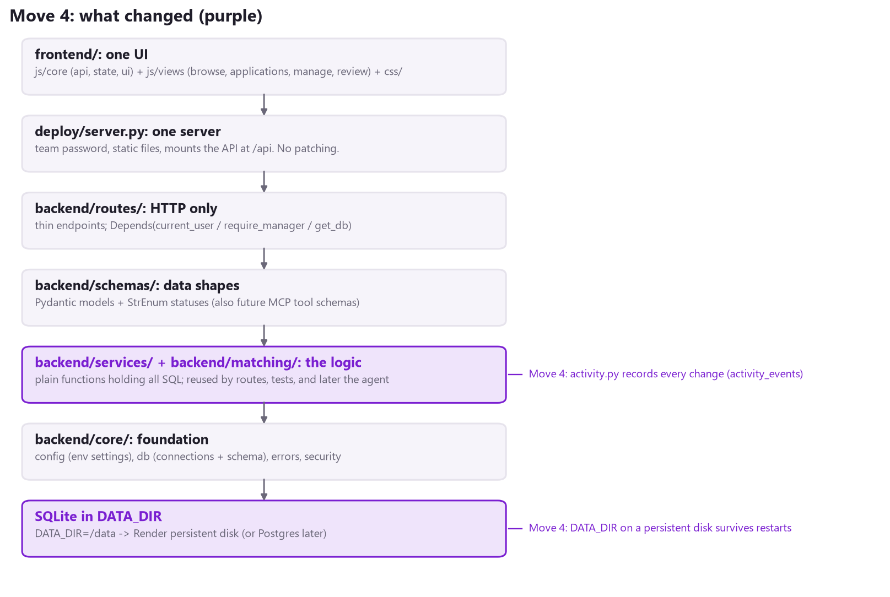
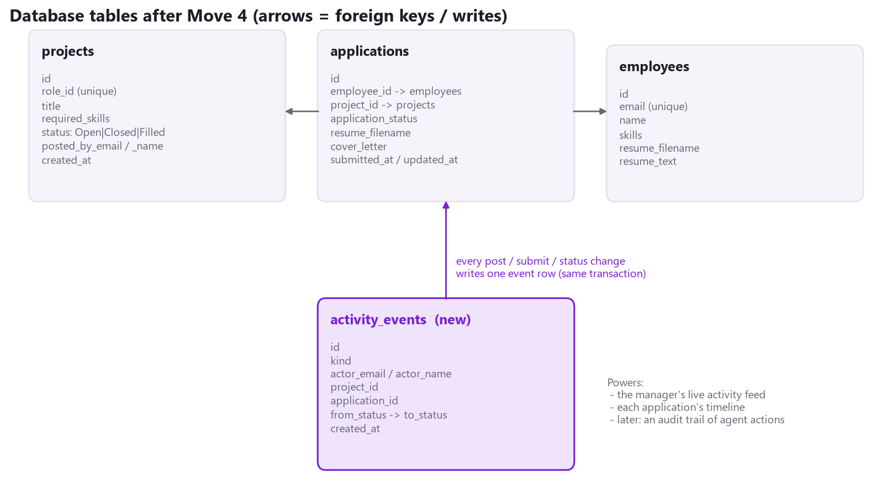
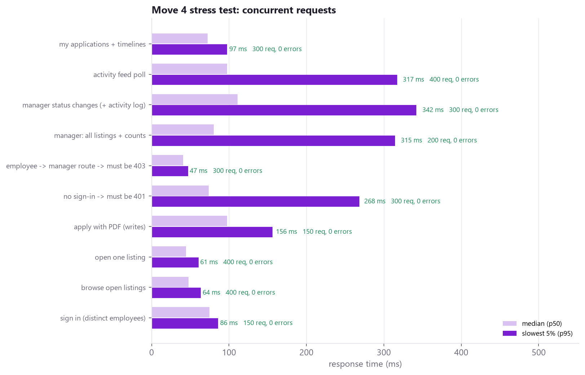

# Phase 3 - Move 4: Data That Survives + the Activity Log

Branch: `phase3`. Folders walked through: `backend/services/activity.py`, `backend/schemas/insights.py`, `backend/routes/insights.py`, `backend/core/db.py`, `deploy/render.yaml`. This fixes the demo blocker ("my listing disappeared") and covers pre-agent readiness items 4 and 5.

## 1. In one sentence

The app can now **keep its data across restarts** (proven with the real container), and **every change anyone makes is written to an activity log**. That log powers a live feed for managers, a progress tracker for employees, and later an audit trail of what the agent did.



## 2. Part A: data that survives restarts

### Why listings disappeared

On Render's free plan the container's disk is temporary. Every restart, deploy, or wake-up from sleep starts a new container with an **empty** `/data` folder, and the startup code loads the 10 demo projects again. (Full explanation: `listing_persistence_walkthrough.pdf`.)

### What changed

Since Move 1, **everything** the app stores lives in one folder, `DATA_DIR` (`/data` in the container): the database and the resumes. Keeping data is therefore one setting on Render, with **no code change**:

| Render setting (service -> Disks) | Value |
|---|---|
| Mount path | /data |
| Size | 1 GB is plenty (SQLite + resumes) |
| Instance type | must be a paid type (free instances cannot have disks) |

`deploy/render.yaml` now carries the same thing as a commented `disk:` block, ready to switch on.

### How you can tell it worked: /api/health

A new marker file, `DATA_DIR/data_created.txt`, is written **once**, the first time a data folder is used. `GET /api/health` reports it:

```
{ "status": "healthy",
  "server_started": "2026-11-13T09:00:12Z",
  "data_since":     "2026-11-10T14:31:05Z" }
```

- If `data_since` is **older** than `server_started`, the data survived a restart.
- If they are about **the same**, this server started with an empty folder.

The server also prints the folder and date in the Render log at startup.

## 3. Part B: the activity log



### Walkthrough: backend/services/activity.py (89 lines)

| Function | What it does |
|---|---|
| record(db, kind, actor, ...) | Adds one row: what happened, who did it (the signed-in User), which listing/application, from which status to which. **It does not commit**: it runs inside the caller's `transaction()`, so the change and its log line are saved together or not at all. |
| describe(event) | Turns a row into a sentence: "Morgan Manager moved Erin Employee on QA Tester to Accepted". |
| recent(db, after_id, limit) | The newest events. `after_id` lets the page ask only for what is new since its last poll. |
| timelines(db, application_ids) | Each application's steps, oldest first, for many applications in **one** query (no query per row). |

**Where record() is called.** There are four places, each inside an existing transaction in a service:

| Service function | Event kind | Example sentence |
|---|---|---|
| projects.create | listing_posted | Morgan Manager posted Teams bot developer |
| projects.set_status | listing_status | Morgan Manager marked QA Tester as Filled |
| applications.submit | application_submitted | Erin Employee applied to QA Tester |
| applications.set_status | application_status | Morgan Manager moved Erin Employee on QA Tester to Accepted |

To make that possible, these services now take the signed-in **User** (from Move 3's dependencies) instead of separate name and email strings. Routes pass it straight through:

```
def change_status(application_id: int, change: ApplicationStatusChange,
                  manager: User = Depends(require_manager), db=Depends(get_db)):
    return applications.set_status(db, application_id, change.status, manager)
```

### New and changed endpoints

| Endpoint | Who | What |
|---|---|---|
| GET /api/insights/activity?after_id=0 | manager | The live feed (routes/insights.py) |
| GET /api/applications/mine | employee | Each application now includes timeline: [Submitted, Under Review, ...] |
| GET /api/health | anyone past the team password | server_started + data_since |

**Real-time without websockets.** The page asks `GET /api/insights/activity?after_id=<newest id seen>` every few seconds (Move 5 builds that screen). Usually the answer is an empty list, which is very cheap. Polling is a deliberate choice: one plain GET is far easier to explain and debug than a websocket connection, and fast enough for a marketplace.

## 4. Tests: 52 passed (7 new in tests/features/test_activity.py)

| Test | What it proves |
|---|---|
| test_every_change_is_logged_with_its_author | Post, apply, accept, fill: 4 events, 4 correct sentences, newest first |
| test_a_failed_change_leaves_no_log_line | A refused duplicate application writes **no** event (same transaction) |
| test_polling_only_returns_new_events | after_id returns nothing until something new happens, then only that |
| test_application_timeline_oldest_first | Submitted -> Under Review -> Accepted, with who decided |
| test_feed_endpoint_for_managers_only | Managers get sentences; employees get 403 |
| test_restart_on_the_same_data_folder_keeps_everything | Two server runs on one data folder: listing, log and data_since all kept |
| test_a_new_data_folder_starts_fresh | A new folder (what Render free does) shows only the 10 demo listings |

The automatic security test from Move 3 picked up the new `/api/insights/activity` route by itself, and failed until it was added to the manager-only list. The safety net worked as designed.

## 5. Stress tests

### The real container: tests/stress/persistence_check.py, 6/6 passed

The same Docker image Render builds, run twice:

| Check | Result |
|---|---|
| A. With a volume at /data: listing survives `docker restart` | PASS |
| A. The application survives too | PASS |
| A. The activity log survives too | PASS |
| A. data_since unchanged and older than server_started | PASS |
| B. Without a volume: the listing is gone after a new container | PASS |
| B. ...and the 10 demo listings are back | PASS |

### Load: 3,000 requests, 0 errors



- New scenarios: **300 concurrent status changes**, each writing its activity row; **400 activity-feed polls**; and **300 "My applications" loads** with timelines.
- Writes that now also log stay at about 110 ms median with 25 at once.
- **UI walkthrough in Edge: 8/8 passed** (nothing on screen changed in this move).

## 6. Honest notes

- **The disk costs money.** Render's free plan cannot have one. The alternative is a hosted Postgres database plus file storage, which is the bigger "Round 2" change and needs team sign-off.
- **Disk ownership on Render** is not verified yet. The container runs as a normal user (`appuser`). If Render mounts the disk owned by root, startup will fail with a permission error on `/data`. Check the first deploy log. (A local Docker volume works, as tested above.)
- **Sessions** still live in memory, so people sign in again after a restart even though their data is kept.
- **Backups:** a disk keeps data across restarts, not across mistakes. Copying `/data/projecthub.db` on a schedule is a sensible next step.
