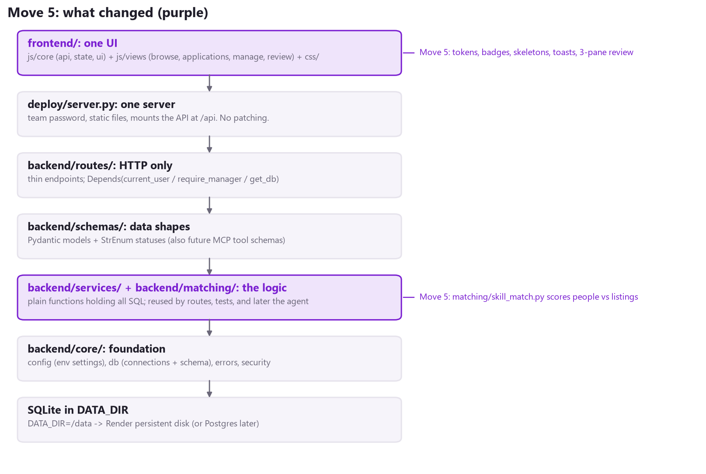
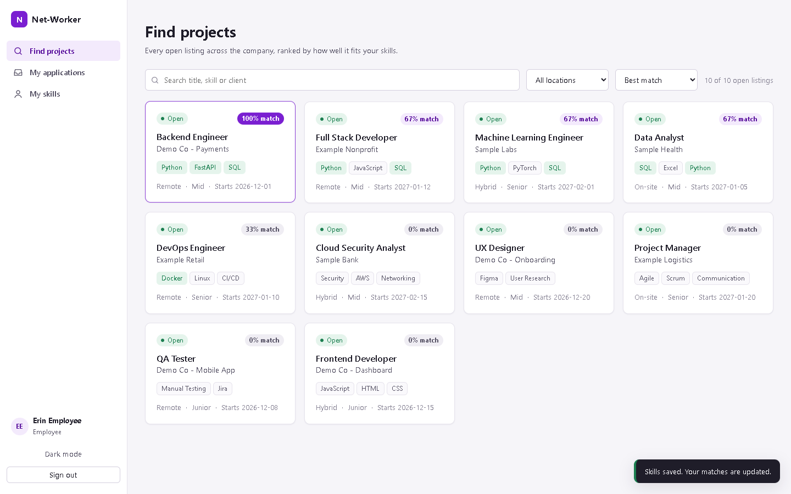
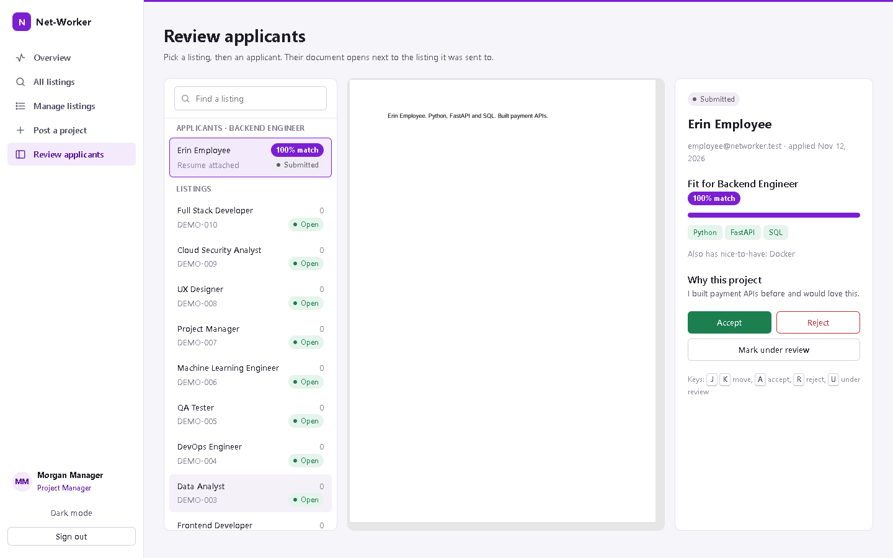
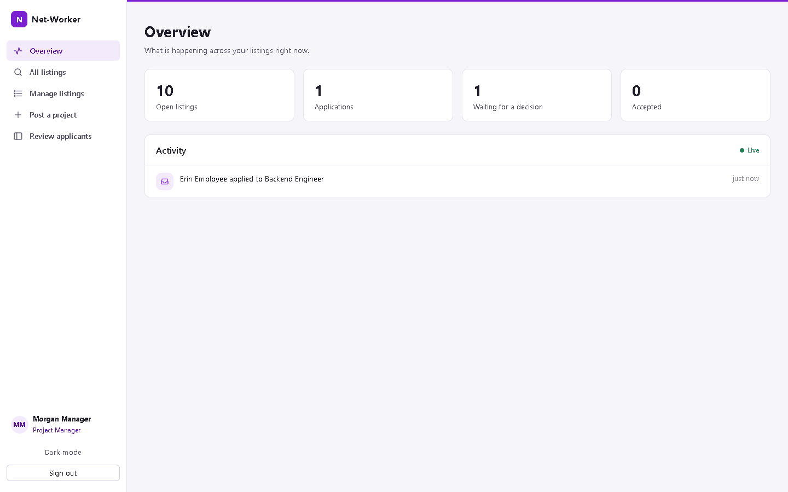
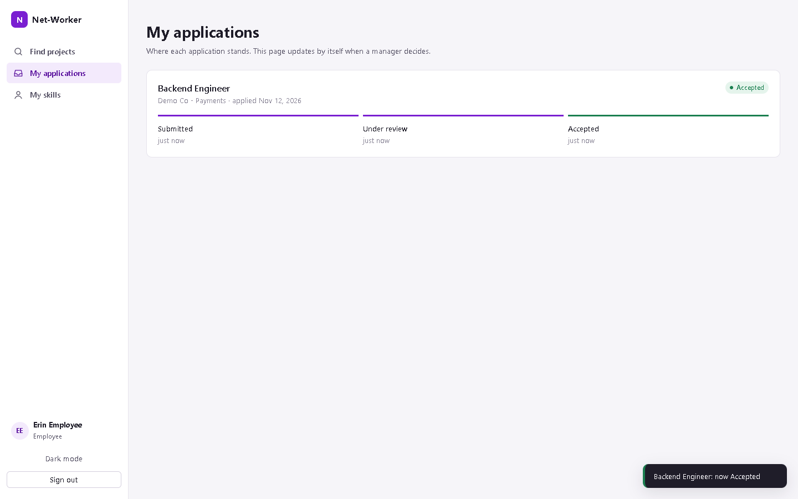
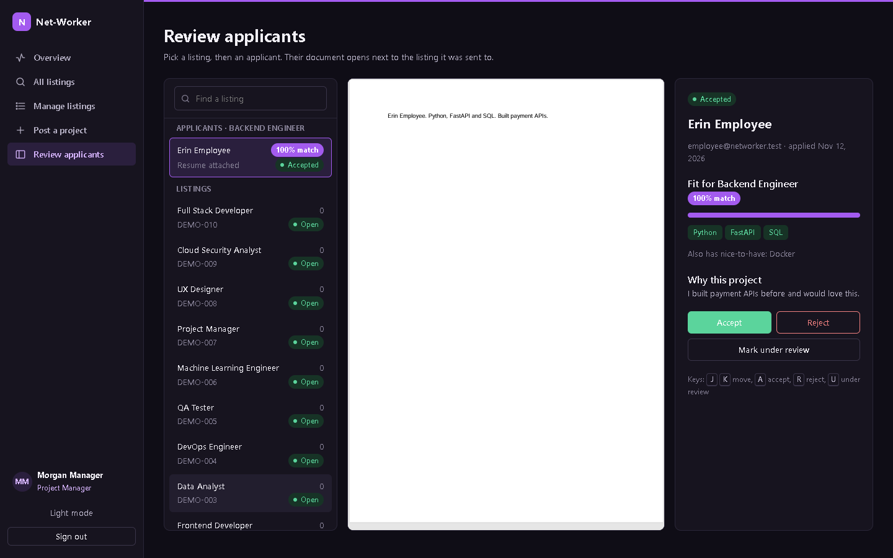
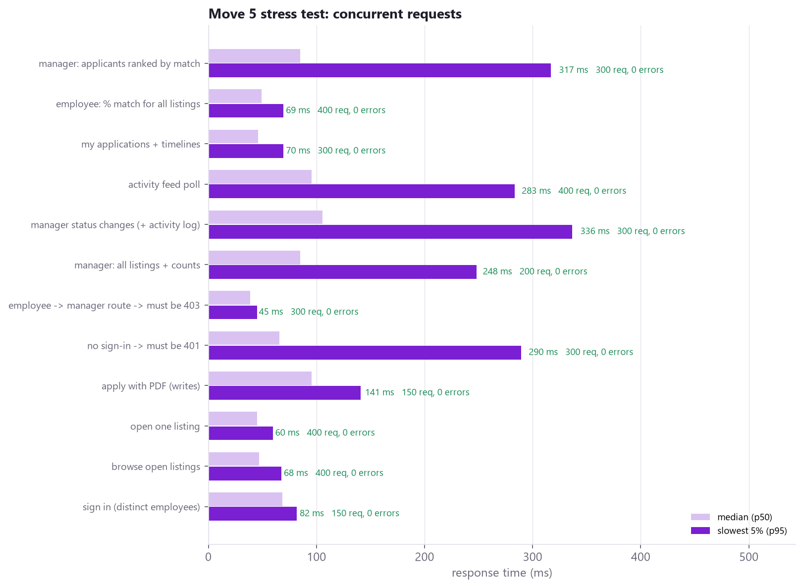
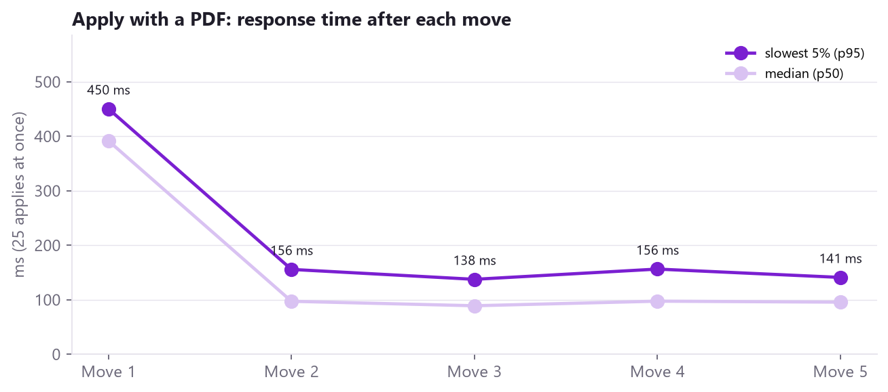

# Phase 3 - Move 5: The UI Pass + the Headline Features

Branch: `phase3`. Folders walked through: `frontend/` (css/, js/core/, js/views/) and `backend/matching/`, plus the matching and profile endpoints. This covers audit Sections 2 (de-vibe-coding the GUI) and 3.1 to 3.3 (skill match, status tracker, live activity feed).

## 1. In one sentence

The site now looks like an internal enterprise tool: a Teams-style left rail, flat purple-accented surfaces, one badge system, loading skeletons, toasts, and a 3-pane review screen. It also has three features that demo well: **"% match" on every listing**, a **tracker that updates by itself**, and a **live activity feed**.

## 2. What the screens look like now

**Employee: "Find projects", ranked by fit.** Every card shows its % match, and the matching skills turn green.

**Manager: Review applicants.** On the left are the listing and its applicants, ranked by match. The PDF sits in the centre, and the decision panel is on the right.

**Manager: Overview.** Headline numbers, plus the live activity feed.

**Employee: My applications.** The tracker moved to "Accepted" on its own, with no reload, while the manager clicked Accept in another window.

**Dark mode** (one click, remembered per browser):

## 3. Walkthrough: frontend/ (13 files, all under 250 lines)

| Folder / file | Lines | Job |
|---|---|---|
| index.html | 88 | The page skeleton: login wall, app shell (rail + main), drawer, toast area |
| css/tokens.css | 97 | **Every** color, size and spacing value. Light theme + dark theme. Nothing else hard-codes a color. |
| css/base.css | 192 | Page layout: login wall, the left rail, phone-width layout |
| css/components.css | 229 | Buttons, inputs, badges, match pills, chips, cards, skeletons, drawer, toasts, tables |
| css/views.css | 127 | Screen layouts: feed toolbar, overview tiles + feed, tracker stepper, 3-pane review |
| js/core/api.js | 45 | The **one** API client: apiFetch / sendJSON / sendForm. 401 sends you to the login wall. |
| js/core/ui.js | 135 | Small helpers: badge(), matchPill(), skeletonCards(), emptyState(), toast(), polling, icons, dates |
| js/core/components.js | 190 | Shared by both roles: ListingCard, ProjectMetadata, MatchBreakdown, renderJobFeed, Stepper |
| js/views/employee.js | 198 | EmployeeDashboard: Find projects, My applications (live), My skills |
| js/views/manager.js | 163 | ManagerAdminDashboard: All listings, Manage listings (pipeline), Post a project |
| js/views/review.js | 191 | The 3-pane review screen + keyboard shortcuts |
| js/views/activity.js | 80 | Manager overview: KPI tiles + the live activity feed |
| js/app.js | 201 | Login wall, theme toggle, and the router (#/role/page) |

**Still vanilla JavaScript**: no framework or build step, matching the rest of the repo. Each screen is a plain function that fills a box with HTML.

### What changed visually (audit Section 2)

| Before | After |
|---|---|
| Purple radial-gradient background, gradient buttons with glow | Flat surfaces. Purple is used only for primary actions, focus and the active page. |
| Ten equally loud "Apply" buttons per screen | The whole card opens a details drawer; **one** primary action inside it |
| Status as plain text or colored text | One badge system with one color per status, and the word is always shown |
| "Loading...", empty paragraphs, alert() | Skeleton cards, designed empty states with an action, toasts |
| Native dropdown to pick a listing; status dropdown | Searchable listing list; Accept / Reject / Under review buttons; keys J K A R U |
| Top text tabs | Teams-style left rail with icons. Manager mode adds a thin purple line on top of every page. |
| Dark only | Light by default (better on projectors), dark mode one click away |

## 4. The headline features

### 4.1 "% match" (backend/matching/skill_match.py, 78 lines, no AI)

The rules are simple enough to explain on a slide:

1. Split the listing's required skills: "Python; FastAPI; SQL".
2. A skill counts if it is in the person's **skills list** or appears as a **whole word in their resume text** (which we already extract from the PDF or DOCX).
3. Score = matched / required, shown as a percentage. Nice-to-have skills are a bonus and never lower the score.

Details a reviewer might poke at, all tested:

- "JS" counts as JavaScript (a small alias list).
- "Java" does **not** match "JavaScript", and "R" does not match inside "React" (whole words).
- "C++" works.
- A listing with no requirements scores 0%, never a fake 100%.

| Endpoint | Who | What |
|---|---|---|
| GET /api/insights/matches | employee | % match for every Open listing |
| GET / PUT /api/applications/profile | employee | My skills (creates the profile on first use) |
| GET /api/projects/{id}/applications | manager | each applicant now carries match: {score, matched, missing, bonus} |
| GET /api/applications/{id}/document | manager | the viewer gets the same match breakdown |
| GET /api/projects/manage | manager | per-listing pipeline: new / in review / accepted / rejected counts |

### 4.2 The tracker that updates itself

"My applications" asks the server again every 10 seconds (while the tab is visible) and redraws a 3-step stepper from the **timeline** that Move 4 records. When a status changes between two refreshes, a toast says so: "Backend Engineer: now Accepted".

### 4.3 The live activity feed

The manager's Overview polls `GET /api/insights/activity?after_id=<newest seen>` every 5 seconds. New lines slide in highlighted, and the headline numbers refresh when something changes.

**One timer at a time.** `startPolling()` in ui.js keeps a single timer. The router stops it on every page change, and it also stops itself if its page is gone.

## 5. Two real bugs the stress tests caught (and the fixes)

1. **A slow page could draw over a newer one.** If you left a page before its data arrived, the old page finished late and replaced the new page's content. The fix is in `route()`: every page now draws into its own fresh box, so a late answer lands in a box that is no longer on screen.
2. **"My skills" could erase what you typed.** The form appeared, then the saved skills loaded and overwrote anything typed in the meantime. The fix keeps the form disabled ("Loading your skills...") until the saved value arrives.

Both were invisible when clicking slowly by hand and caught by the automated Edge walkthrough. That is exactly the kind of bug that shows up in a live demo.

## 6. Tests

**pytest: 65 passed** (13 new in tests/features/test_matching.py): splitting rules, 7 scoring cases (aliases, whole words, symbols, resume text, no requirements), bonus skills, profile to matches through the API, resume text counting after applying, managers seeing ranked applicants and pipeline counts, and profile/matches being employee-only.

**Edge walkthrough (two windows at once): 16/16 checks, 3 runs in a row**

| Check | Result |
|---|---|
| Login wall offers both roles | PASS |
| Feed shows % match on all 10 cards; best match first (100%) | PASS |
| Drawer explains the fit (green matched skills) | PASS |
| Apply with a PDF; tracker shows Submitted | PASS |
| Manager Overview shows "applied to ..." live | PASS |
| PDF inline next to the listing; applicant ranked with % match | PASS |
| Keyboard U = Under Review; Accept saved with a toast | PASS |
| **Employee tracker turns Accepted by itself, no reload** | PASS |
| Stepper reaches all three steps | PASS |
| Dark mode switches the theme | PASS |
| Phone width (390 px): no sideways scrolling | PASS |
| No JavaScript errors in any window | PASS |

**Load: 3,600 requests, 0 errors**, including 400 "% match for all listings" (about 70 ms at p95) and 300 ranked applicant lists.

> Honest note on the load test: one run showed 10 "ReadError" failures in a single scenario. The cause was a race in the test tool, not the app. Connections idle for 5 s (uvicorn's default keep-alive) were closed by the server just as the test client reused them. Browsers retry in that case; the test client does not. The load test now runs the server with a 30 s keep-alive, and two repeat runs had 0 errors.

**Across all five moves, applying with a PDF went from 450 ms to about 140 ms at p95:**

## 7. Honest notes

- **Matching is keyword-based on purpose.** It is explainable and predictable. A smarter version (synonyms, seniority, embeddings) is a natural first job for the agent, behind the same `score()` contract.
- **Polling, not websockets.** That is fine for tens of users. For hundreds, server-sent events would be the next step.
- **Only Edge (Chromium) was tested.** Firefox and Safari were not. Hiding the PDF toolbar (`#toolbar=0`) is a Chromium feature; other browsers simply show their own toolbar.
